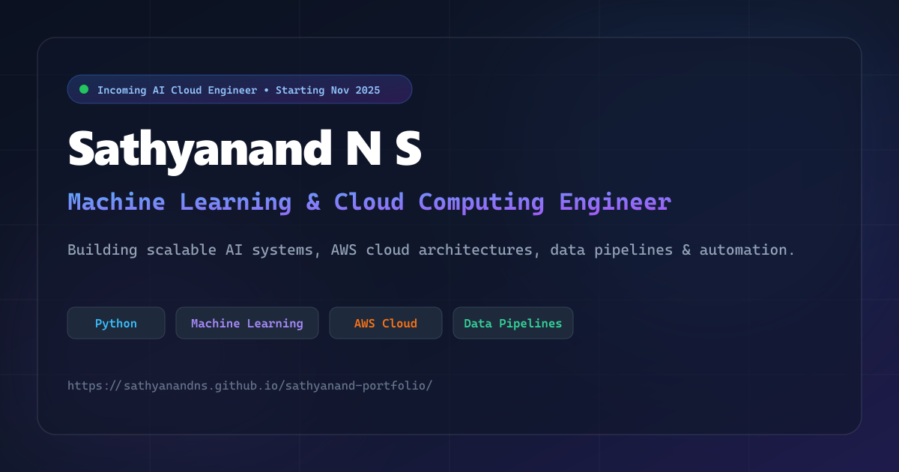

# Sathyanand N S — Machine Learning & Cloud Computing Portfolio

A high-performance personal portfolio website for **Sathyanand N S**, an AI & Cloud Computing Engineer specializing in Python, Machine Learning, AWS cloud deployments, data pipelines, and automation.

🌐 **Live URL:** [https://sathyanandns.github.io/sathyanand-portfolio/](https://sathyanandns.github.io/sathyanand-portfolio/)

---



---

## 🚀 Key Features & Highlights

- **Interactive Project Showcase:** Filter projects dynamically across **ML**, **AWS**, and **Data Pipeline** categories.
- **Deep Technical Credibility:**
  - Machine learning models evaluated with real benchmark dataset context (UCI / Kaggle 11,055 sample set, 80/20 stratified cross-validation, precision/recall metrics).
  - Clear architectural flow diagrams for cloud-deployed systems (EC2, S3, IAM, Flask, Gunicorn/Nginx reverse proxy).
  - Direct repository and live demo links per project.
- **Accessible & Compliant (WCAG 2.1 AA):**
  - Project cards implemented as semantic, keyboard-accessible `<article>` components responding to both `Enter` and `Space`.
  - Full modal focus trap with `Escape` dismiss and previous-element focus restoration.
  - Skip-to-content navigation link.
  - Accessible color contrast across both light and dark modes.
  - Native `IntersectionObserver` section highlighting without scroll-event layout thrashing.
- **Robust Contact System:**
  - Real form submissions via configurable endpoint (Formspree / EmailJS) with loading, success, and error states.
  - Anti-spam hidden honeypot field.
  - Obfuscated click-to-reveal phone and email preventing scraper harvesting.
  - Direct `mailto:` client fallback.
- **UX Polish:**
  - System-aware Dark / Light mode toggle with persistent `localStorage` preference.
  - Real-time scroll progress indicator bar.
  - Smooth back-to-top floating control.
  - Dedicated custom `404.html` fallback.
- **High-Performance Architecture:**
  - Modern WebP image formats with explicit dimensions for zero layout shift (CLS).
  - Below-the-fold component lazy loading via `React.lazy` and `Suspense`.
  - Optimized Google Fonts loading with tailored font weights.
  - Client bundle strictly optimized under 300 KB JS.
- **Comprehensive SEO & Social Sharing:**
  - Rich JSON-LD `Person` schema markup.
  - Canonical URL, OpenGraph 1200×630 metadata banner, and Twitter Cards.
  - `robots.txt` and `sitemap.xml` included out of the box.

---

## 🛠️ Tech Stack

- **Frontend:** [React 19](https://react.dev/) + [TypeScript](https://www.typescriptlang.org/)
- **Bundler & Dev Server:** [Vite 8](https://vitejs.dev/)
- **Icons:** [Lucide React](https://lucide.dev/)
- **Styling:** Modular CSS Design System with CSS Custom Properties
- **Deployment:** GitHub Pages via GitHub Actions CI/CD

---

## 💻 Running Locally

### 1. Clone the repository

```bash
git clone https://github.com/Sathyanandns/sathyanand-portfolio.git
cd sathyanand-portfolio
```

### 2. Install dependencies

```bash
npm install
```

### 3. Optional Environment Configuration

Create a `.env` or `.env.local` file to connect a real form submission service (e.g. Formspree):

```env
VITE_FORM_ENDPOINT=https://formspree.io/f/your-form-id
```

*(If omitted, contact form gracefully falls back to opening the user's email client via `mailto:`).*

### 4. Start the development server

```bash
npm run dev
```

Open `http://localhost:5173/sathyanand-portfolio/` in your browser.

### 5. Build and Preview for Production

```bash
npm run build
npm run preview
```

---

## 🌐 Deployment Configuration

This site is deployed to **GitHub Pages** as a project site.

- **Vite Base Path:** In `vite.config.ts`, `base: '/sathyanand-portfolio/'` is set so that all scripts, styles, SVGs, WebP images, and the PDF resume resolve reliably at `https://sathyanandns.github.io/sathyanand-portfolio/`.
- **Automated CI/CD:** `.github/workflows/deploy.yml` triggers on every push to `main`, installing dependencies, running `npm run build`, and deploying the `dist/` directory directly to GitHub Pages.

---

## 📬 Contact & Links

- **Name:** Sathyanand N S
- **Role:** AI & Cloud Computing Engineer
- **Location:** Coimbatore, Tamil Nadu, India
- **GitHub:** [https://github.com/Sathyanandns](https://github.com/Sathyanandns)
- **LinkedIn:** [https://www.linkedin.com/in/sathyanand-n-s-0759a4254](https://www.linkedin.com/in/sathyanand-n-s-0759a4254)
